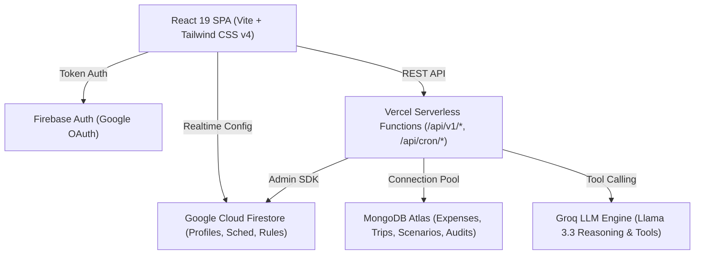

# WorkTrip AI — Hybrid Work Travel & Expense Optimizer (10-User Production MVP)

[](https://github.com)
[](https://www.typescriptlang.org/)
[](https://react.dev/)
[](https://tailwindcss.com/)
[](https://vitest.dev/)

**WorkTrip AI** is a production-grade, multi-tenant hybrid work intelligence and expense optimization engine tailored for hybrid professionals commuting between home hubs and office locations (e.g., Mumbai ⇄ Pune HQ).

---

## 🚀 Key System Capabilities

- 🗓️ **Precision Hybrid Planning**: Manage WFO/WFH baseline schedules, calendar exceptions, holiday bridges, and leave overrides with zero scheduling conflicts.
- 🚆 **Multi-Leg Trip & Accommodation Engine**: Automatically generates travel segments (train, flight, cab, corporate PG/hotel) based on office attendance patterns.
- 💳 **Expense & Budget Tracking**: Real-time spending aggregation, monthly budget utilization tracking, and financial variance vs. initial planned forecast.
- 🤖 **Two-Phase Deterministic AI Assistant**: Conversational agent powered by typed backend tools (`calculateWeeklyCost`, `runCostOptimizer`, `setWFH`, `setWFO`), structured ChangeSets, confirmation dialogs, change previews, and full **Undo** support.
- ⚡ **Automated Vercel Cron Dispatcher**: Daily automated cron job running idempotent schedule reconciliation, expense aggregation, and alert dispatches.
- 🛡️ **Dual-Database Tenant Isolation**: Fast document configuration in **Firestore** and query-heavy analytics/audits/expenses in **MongoDB Atlas** — both strictly scoped by authenticated `userId`.
- 🔐 **Privacy & Data Governance**: 1-click personal application data export (JSON) and strong two-step account deletion purging all Firestore and MongoDB tenant data.

---

## 🏗️ Architecture Overview



---

## ⚡ Quick Start

### 1. Prerequisites
- **Node.js**: `v20.x` or `v22.x`
- **Package Manager**: `npm`
- **Databases**: MongoDB Atlas Cluster & Firebase Project with Firestore enabled

### 2. Installation
```bash
git clone <repository_url>
cd Project
npm install
```

### 3. Configure Environment Variables
Copy `.env.example` to `.env`:
```bash
cp .env.example .env
```
Fill in the client Firebase credentials (`VITE_FIREBASE_*`) and backend credentials (`FIREBASE_PROJECT_ID`, `FIREBASE_CLIENT_EMAIL`, `FIREBASE_PRIVATE_KEY`, `MONGODB_URI`, `GROQ_API_KEY`, `CRON_SECRET`).

### 4. Run Locally
```bash
# Start local development server
npm run dev

# Run Vitest test suites (18 suites / 179 tests)
npm test

# Check TypeScript types
npm run typecheck

# Production build preview
npm run build
npm run preview
```

---

## 📖 Complete Documentation Index

For detailed architectural and deployment specifications, see the [`docs/`](./docs) folder:

- 🏛️ [System Architecture (`docs/architecture.md`)](./docs/architecture.md)
- ⚙️ [Local Setup & Dev (`docs/setup.md`)](./docs/setup.md)
- 🔑 [Environment Configuration (`docs/environment.md`)](./docs/environment.md)
- 🗄️ [Database Architecture (`docs/database.md`)](./docs/database.md)
- 🛡️ [Firestore Security Rules (`docs/firestore-rules.md`)](./docs/firestore-rules.md)
- 📡 [API Specification (`docs/api.md`)](./docs/api.md)
- 🧠 [AI Architecture & Guardrails (`docs/ai-architecture.md`)](./docs/ai-architecture.md)
- 🛠️ [Deterministic AI Tools (`docs/ai-tools.md`)](./docs/ai-tools.md)
- ⏰ [Scheduling Engine & Cron (`docs/scheduling.md`)](./docs/scheduling.md)
- 🚢 [Production Deployment Guide (`docs/deployment.md`)](./docs/deployment.md)
- 🧪 [Testing & Quality Verification (`docs/testing.md`)](./docs/testing.md)
- 🔒 [Security & Data Governance (`docs/security.md`)](./docs/security.md)

---

## 🧪 Testing Results

WorkTrip AI enforces 100% test passing before deployment:
```text
Test Files  18 passed (18)
     Tests  179 passed (179)
  Duration  31.85s
```

---

## 🛡️ License

Private and Confidential. Developed for WorkTrip AI 10-User Production MVP.
