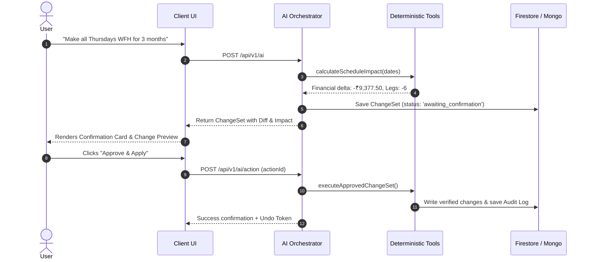

# AI Assistant Architecture & Guardrails — WorkTrip AI

## 1. AI Assistant Philosophy

WorkTrip AI does not allow the LLM to write directly or hallucinate calculations. Instead, it operates through a **Two-Phase Action Verification Engine** backed by deterministic typed tools.

---

## 2. Autonomy Settings & Risk Classification

Actions are classified into three risk tiers:

| Action Type | Examples | Risk Level | Confirmation Required? |
|---|---|---|---|
| **Informational / Read** | `calculateWeeklyCost`, `getExpenseSummary` | Low | No (Auto-executed) |
| **Single-Day Modification** | `setWFH` for 1 day, `createExpense` | Medium | Yes in Balanced/Suggest mode |
| **Bulk Modification / Policy**| `setWFH` for 3 months, `deleteTrip` | High | Always requires explicit confirmation |

---

## 3. Two-Phase Execution & Undo Engine

- Every applied `ChangeSet` stores its `beforeState` and snapshot diff.
- The user can trigger **Undo** at any time to restore the previous state without data loss.
